# Night Owl Books

An online bookstore with a customer storefront and an admin panel. Customers browse a catalog, fill a cart, check out
with a mock card payment and follow their orders. Admins manage books, orders and accounts.

**Live:** https://night-owl-books.vercel.app

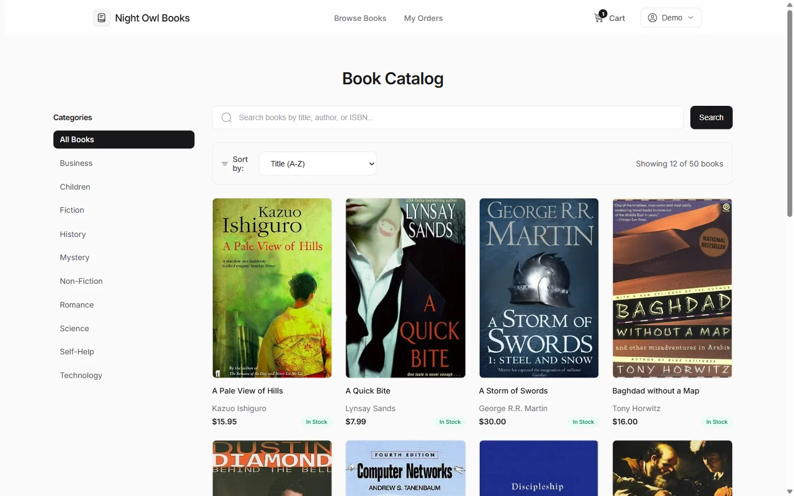

The first version was plain PHP and MySQL. It has been converted to **Next.js (App Router, TypeScript)** on **Vercel**
with **Postgres on Neon**, keeping the same screens, the same stylesheets and the same features.

## What you can do

**Customers**
- Browse 50 books by category, search by title, author or ISBN, sort and page through results.
- Add to cart from the catalog or from a book page (quantity is limited by stock), change quantities, remove items.
- Check out with a mock card payment, then see a confirmation, the order history and a progress view per order.
- Update personal details, address and password.

**Admins**
- Dashboard with real totals (books, orders, users, revenue) and the last 7 days, recent orders and a low-stock list.
- Add, edit and delete books. A book that appears in an order cannot be deleted; set its stock to 0 instead.
- Search and filter orders, change an order's status and add a note. Cancelling puts the books back in stock.
- List and search accounts, view an account's orders, promote a user to admin, delete an account (its orders are kept).

## A look inside

**Storefront (customer)**

| Screen | Preview |
|---|---|
| Sign in, with the demo account shown | 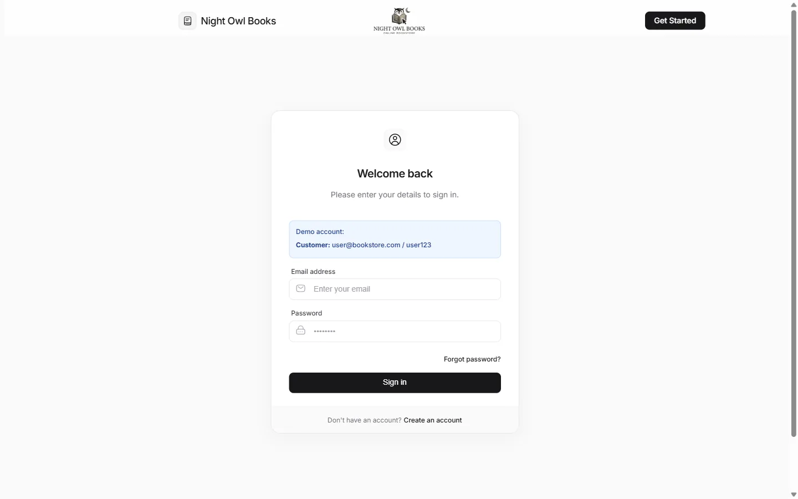 |
| Book page: stock, category, quantity picker | 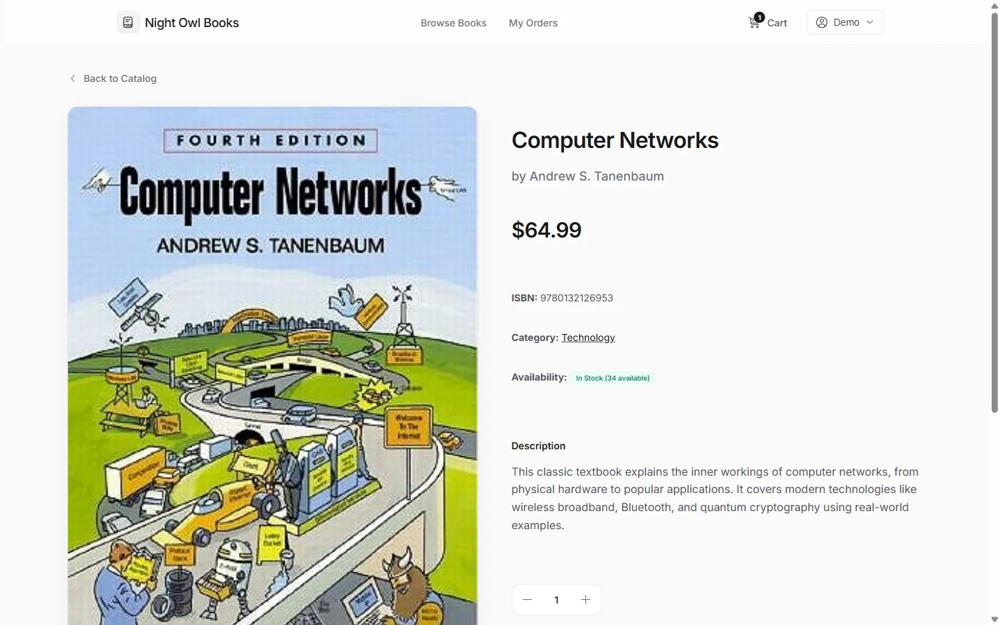 |
| Cart with live subtotal, 8.5% tax and total | 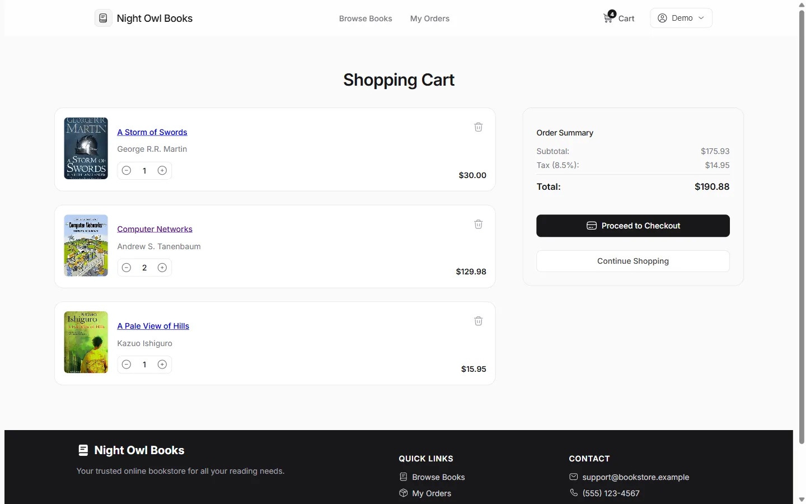 |
| Checkout: shipping details and mock card payment | 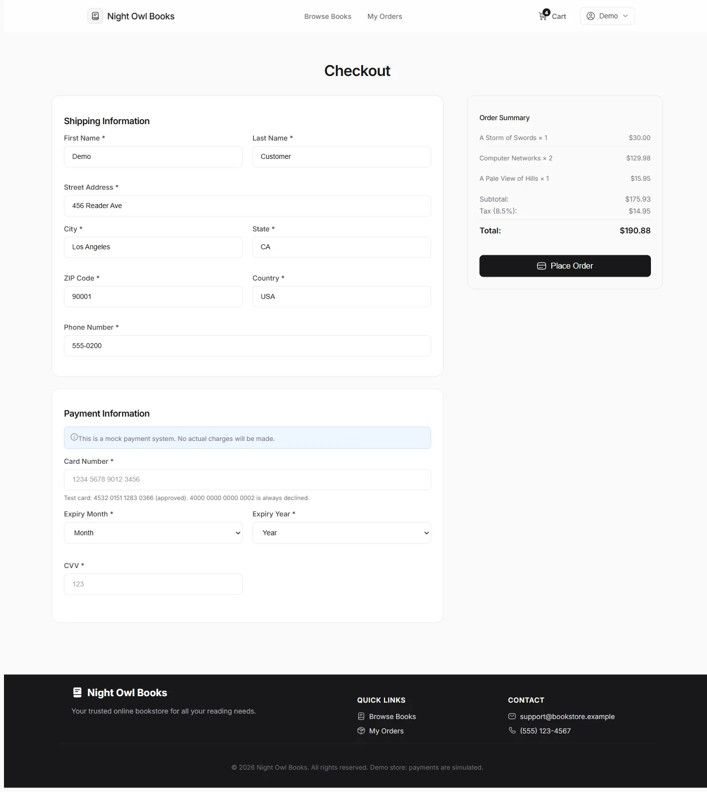 |
| Order history | 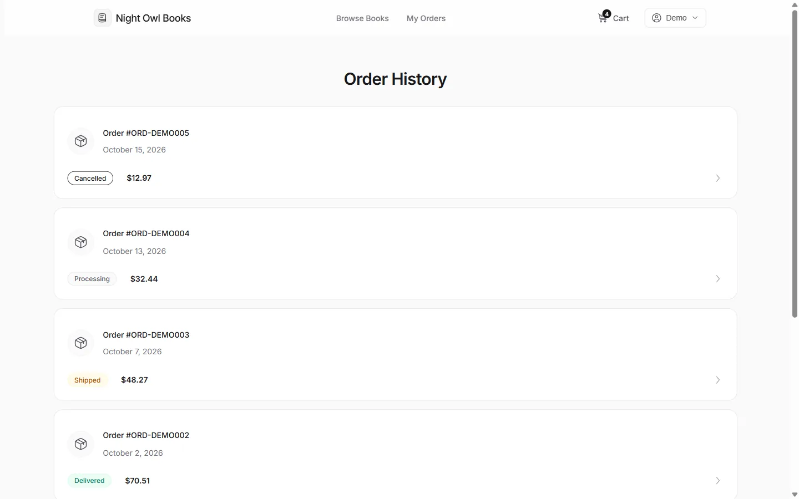 |
| One order: progress, items, address, payment summary | 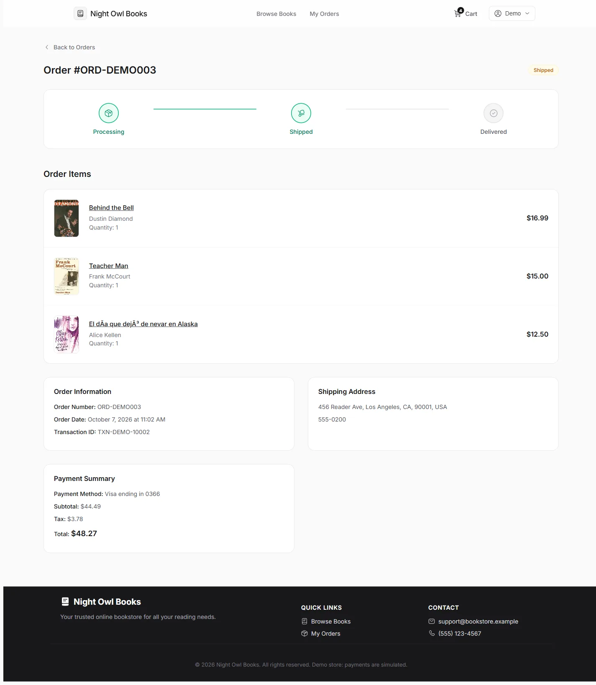 |

**Admin panel**

| Screen | Preview |
|---|---|
| Dashboard: totals, last 7 days, recent orders, low stock | 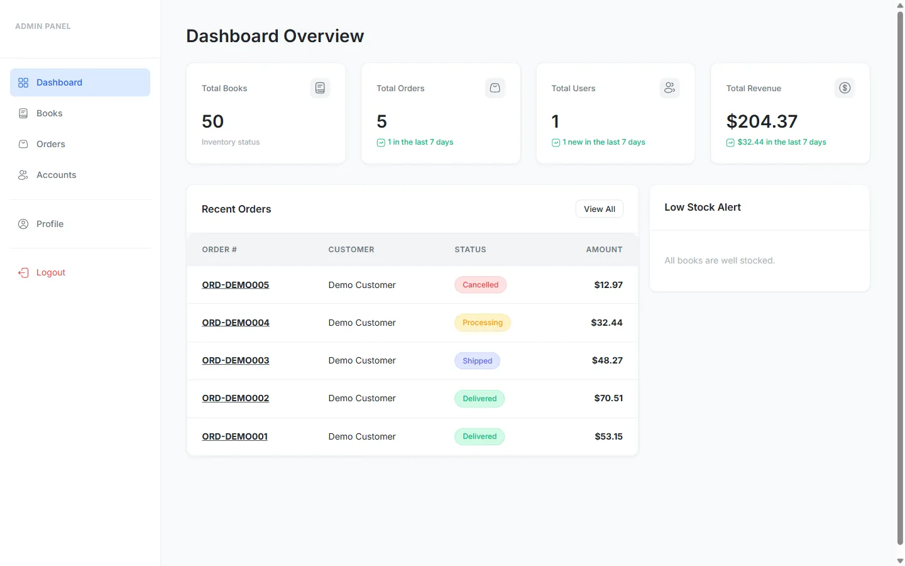 |
| Book management: search, filter, edit, delete | 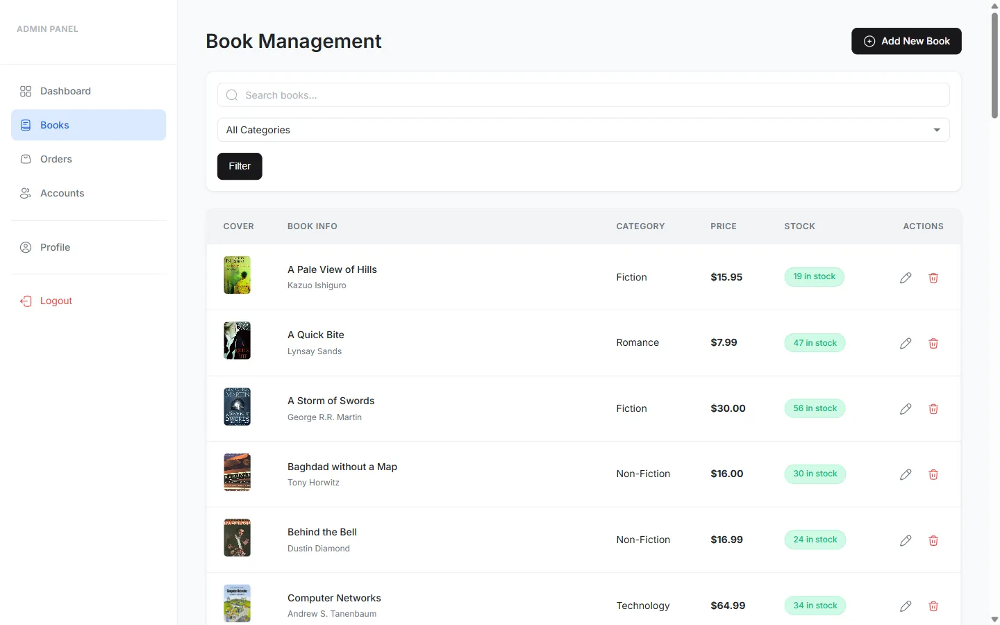 |
| Orders: search and status filter | 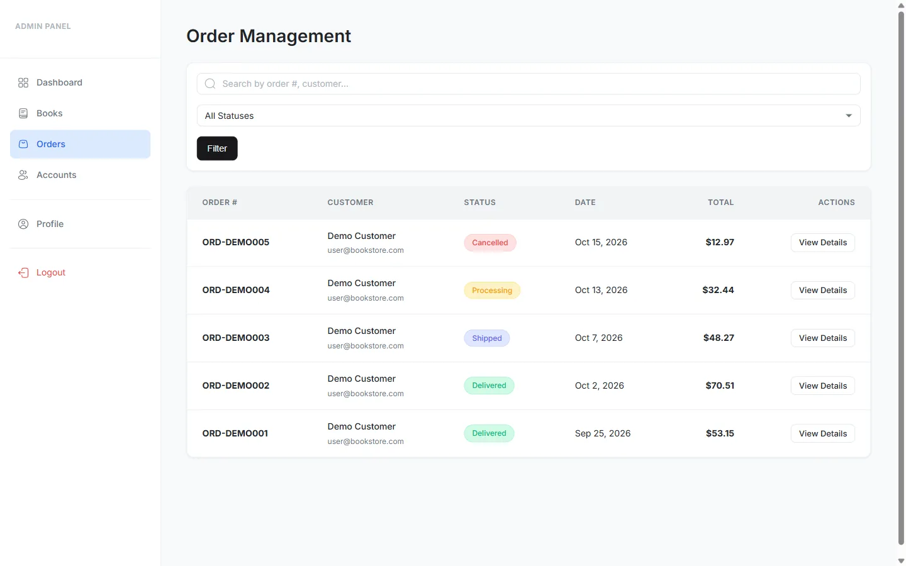 |
| Order detail: customer, items, status and notes | 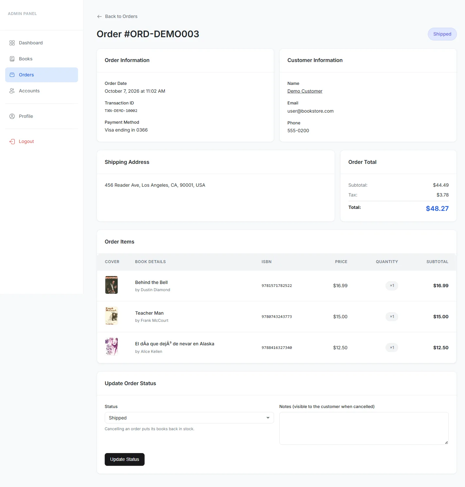 |
| Accounts: roles, delete, order history | 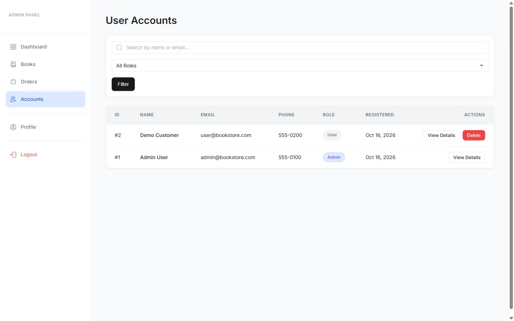 |

**On a phone**

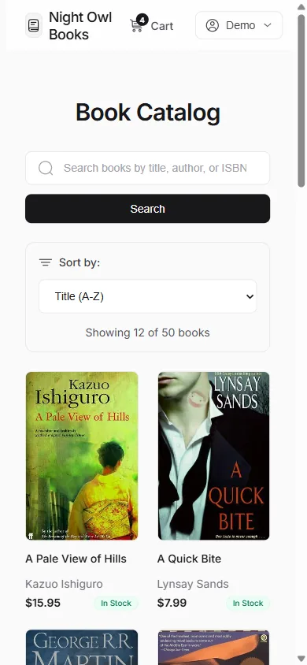

## Demo accounts

| Role | Email | Password |
|---|---|---|
| Customer | `user@bookstore.com` | `user123` |
| Admin | `admin@bookstore.com` | set by `SEED_ADMIN_PASSWORD`, or printed once by `npm run db:seed` |

The admin password is deliberately not published, so visitors to the public demo cannot edit the catalog.

**Test cards** (mock payment, nothing is charged): `4532 0151 1283 0366` is approved, `4000 0000 0000 0002` is always
declined. Any future expiry date and a 3 or 4 digit CVV.

## Stack

| Layer | Choice |
|---|---|
| App | Next.js 16 (App Router, Server Actions), React 19, TypeScript |
| Database | Postgres on **Neon** (AWS Singapore), Drizzle ORM, pooled `pg` connection |
| Sessions | Signed JWT in an HTTP-only cookie (`jose`), 2 hours; the user is read from the database on every request |
| Passwords | bcrypt (`bcryptjs`), compatible with the old PHP `password_hash()` hashes |
| Styling | The original stylesheets, split per area (shop, auth, admin), plus Inter and bundled Solar icons |
| Email | Optional order confirmation through Resend |
| Hosting | Vercel |

## What changed in the conversion

- **Money is stored in whole cents**, so totals and 8.5% tax never pick up floating point error.
- **Checkout is one transaction.** It locks the books being bought, re-checks stock, then writes the order, the lines and
  the stock change together. Two people cannot both take the last copy.
- **Orders keep the customer's name and email**, so deleting an account no longer deletes (or orphans) its orders.
- **Fixed from the PHP version:** the change-password form read a column that does not exist; searches used a
  case-sensitive `LIKE` on Postgres; the cart could exceed stock by adding the same book twice; the mock payment declined
  10% of valid cards at random (now deterministic); the admin dashboard showed made-up trend percentages; `session_id`
  and unused cart columns are gone; the demo admin password was published on the sign-in page.
- **Security:** Server Actions only (Next checks the request origin), every admin action re-checks the role, banner text
  comes from a fixed list of codes rather than from the URL, redirects after sign-in only go to paths on this site.
- **Faster:** icons are bundled instead of fetched from a CDN, fonts are self-hosted by Next, pages are server-rendered.

## Run locally

```bash
npm install
cp .env.example .env.local        # add the Neon strings and a SESSION_SECRET
npm run db:generate               # only needed after changing src/db/schema.ts
npm run db:migrate                # creates the tables (uses DATABASE_URL_UNPOOLED)
npm run db:seed                   # categories, books, two accounts, five sample orders
npm run dev                       # http://localhost:3000
```

Checks:

```bash
npm run lint
npm run typecheck
npm test                          # money, payment, sessions, validation, search
npm run build
```

## Environment variables

| Variable | Needed for | Notes |
|---|---|---|
| `DATABASE_URL` | the app | Neon **pooled** string (host contains `-pooler`) |
| `DATABASE_URL_UNPOOLED` | migrate and seed | Neon direct string |
| `SESSION_SECRET` | the app | 32 or more characters. `openssl rand -base64 32` |
| `NEXT_PUBLIC_SITE_URL` | metadata | The public address, no trailing slash |
| `RESEND_API_KEY`, `EMAIL_FROM` | optional | Order confirmation email. Without a key nothing is sent and orders are unaffected |
| `SEED_ADMIN_PASSWORD` | seed | Password for the admin account. Random and printed once if empty |

## Deploy (Vercel + Neon)

1. Create a Neon project in the region closest to your Vercel function region (this one uses AWS Singapore and `sin1`).
2. Import the repository in Vercel and add `DATABASE_URL`, `SESSION_SECRET` and `NEXT_PUBLIC_SITE_URL` for Production.
3. Set **Settings > Functions > Function Region** to the same region as the database.
4. From your machine, run `npm run db:migrate` and `npm run db:seed` once with `DATABASE_URL_UNPOOLED` set.

## Project structure

```
src/app/(auth)/    sign in, register, terms, privacy, contact
src/app/(shop)/    catalog, book page, cart, checkout, orders, profile (signed-in customers)
src/app/admin/     dashboard, books, orders, accounts, profile (admins only)
src/server/        Server Actions and database queries
src/lib/           money, payment, sessions, validation, email (pure and tested)
src/db/            Drizzle schema, client, seed
drizzle/           SQL migrations
src/styles/        user.css, auth.css, admin.css carried over from the PHP store
```

## Notes

The book covers are links to images on other sites, as in the original data. A dead link shows a plain "No Image" tile
instead of a broken picture. Payments are simulated and the store is a demo.
